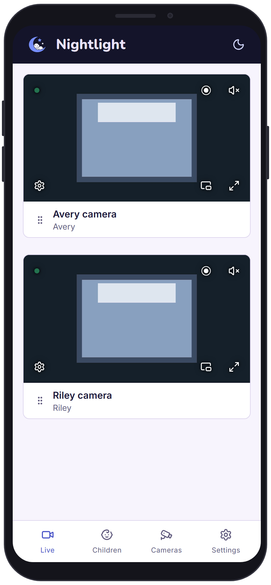
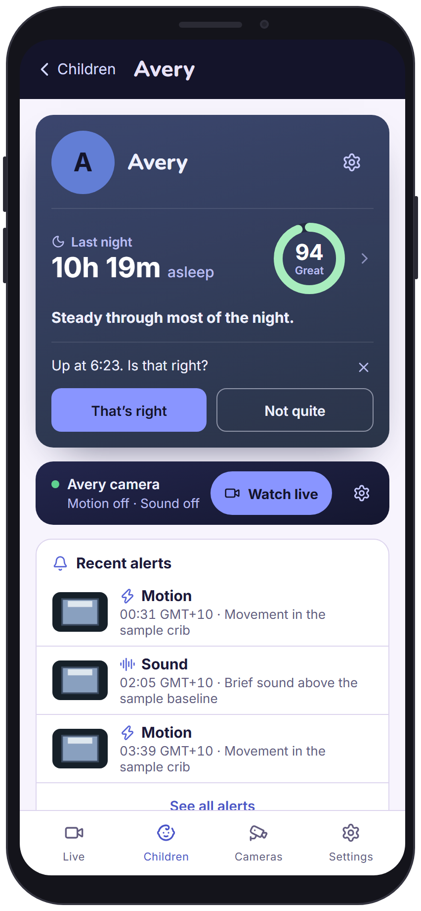
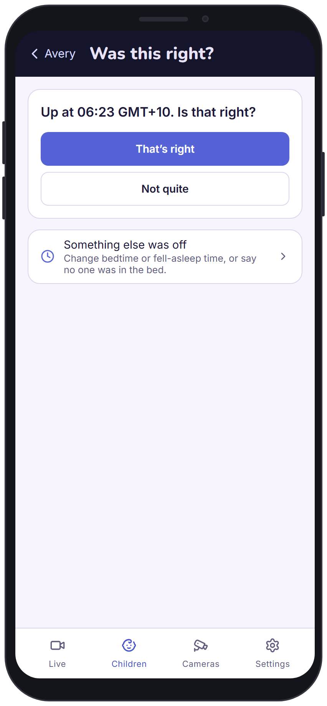
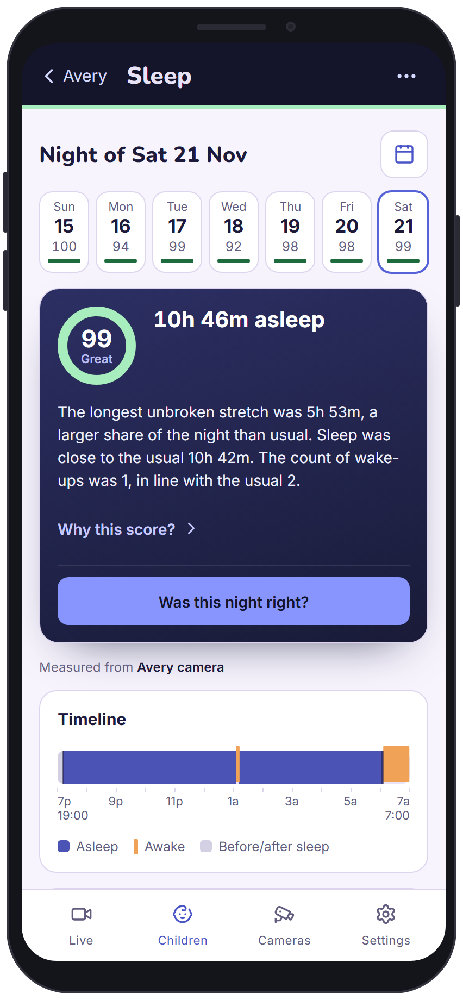
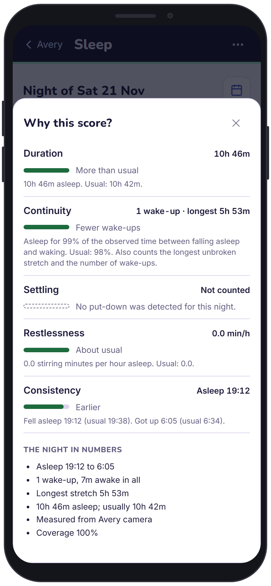
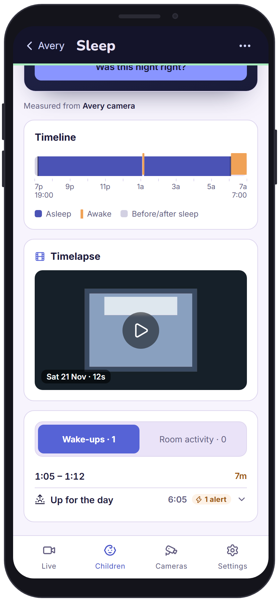

# Nightlight — your cameras, your baby monitor

**A private, self-hosted baby monitor built around the cameras you already own.**

Nightlight brings your nursery cameras together in one place. Check in on your little ones, listen to live audio, follow sleep activity and get optional alerts from your phone or computer — without a subscription or a Nightlight-hosted video service.

Built for parents. Friendly to self-hosters. Open source.

[Website](https://nightlightbaby.app/) · [Quick start](#quick-start) · [Documentation](docs/README.md) · [Report an issue](https://github.com/sauso/nightlight/issues)

> **Important:** Nightlight is a convenience tool, **not a safety or medical device**. Streams and alerts can fail. It must never replace adult supervision or be relied on to detect a child in distress.

## See Nightlight in action

<table>
  <tr>
    <th width="33%" align="center">Live view</th>
    <th width="33%" align="center">A child's last night</th>
    <th width="33%" align="center">Morning check</th>
  </tr>
  <tr>
    <td align="center"></td>
    <td align="center"></td>
    <td align="center"></td>
  </tr>
</table>

[See the full walkthrough](docs/README.md#visual-walkthrough), from first-run setup to a caregiver's view. These are captures of a made-up household with a synthetic camera picture, not live footage or real data, and they may lag behind the latest UI.

## Why Nightlight?

- **Use your existing cameras.** Connect compatible RTSP cameras. On supported ONVIF cameras, Nightlight can fill in the stream details from the camera's IP address.
- **Watch with less delay.** WebRTC provides low-latency live video, with an HLS compatibility option.
- **Keep things in your hands.** Nightlight runs on your own Docker host and stores its settings and recordings locally.
- **One place for the nursery.** Group cameras by child and manage access for caregivers.
- **More than a live feed.** Explore sleep tracking, camera controls, recording and optional notifications.

Nightlight is designed for local-network use first. Remote viewing is possible, but requires additional setup.

## Quick start

You'll need an always-on Linux host running Docker (such as Unraid or an arm64 Raspberry Pi) and a camera that exposes an RTSP stream. ONVIF is useful but optional. Performance depends on your hardware, camera count and enabled analysis features, and there isn't a published minimum-hardware benchmark. [What you need, and what has been tested](docs/requirements.md) says what is known and what isn't.

On Unraid? Jump to [Running on Unraid](#running-on-unraid). On Home Assistant OS? See [Running on Home Assistant](#running-on-home-assistant). Anywhere else, run Nightlight on a trusted home network:

```bash
docker run -d \
  --name nightlight \
  --network host \
  --restart unless-stopped \
  --log-opt max-size=10m \
  --log-opt max-file=3 \
  --stop-timeout 30 \
  -e PUID=99 \
  -e PGID=100 \
  -e TZ=UTC \
  -v /path/to/your/data:/app/data \
  sauso/nightlight:latest
```

Replace `/path/to/your/data` with a persistent folder on your host. `PUID=99` and `PGID=100` suit Unraid; on other hosts, choose the appropriate non-root user and group. Set `TZ` to your timezone if desired (it sets log timestamps and the names of the video buffer files; the times the app shows follow the timezone in Settings → General).

`--stop-timeout 30` gives Nightlight time to finish saving a recording when the container is stopped; without it Docker can kill the container first. `--log-opt` stops Docker's logs growing without limit.

The image is also published at `ghcr.io/sauso/nightlight` under the same tags. [How the two registries relate](docs/operations.md#registries).

Open `http://<server-ip>:4000` from a device on the same network. Create your administrator account, add a child, then connect a camera from the **Cameras** tab.

Prefer Compose, or need different networking or storage settings? See the [installation guide](docs/installation.md).

## Running on Unraid

In **Community Applications**, search for **Nightlight**, select **Install**, check the data directory and apply. No extra plugin is needed. Then open `http://<server-ip>:4000` and follow the steps above to create your administrator account.

**Already installed from an older template?** Unraid keeps your saved template, so it doesn't pick up the shutdown setting by itself. Edit the container and make sure **Extra Parameters** contains `--stop-timeout 30`, so recordings can finish saving when the container stops.

[Manual template install and other setup details](docs/installation.md#unraid)

## Running on Home Assistant

Nightlight runs as an **app** on Home Assistant OS (`amd64` or `aarch64`), added from its own repository. It is **experimental**.

[](https://my.home-assistant.io/redirect/supervisor_add_addon_repository/?repository_url=https%3A%2F%2Fgithub.com%2Fsauso%2Fnightlight-ha-addon)

Or add it by hand: in Home Assistant, go to **Settings → Apps → Install app**, open the menu at the top right, choose **Repositories** and enter `https://github.com/sauso/nightlight-ha-addon`. Then install **Nightlight**, start it and select **Open Web UI**. Older Home Assistant versions call this **Settings → Add-ons → Add-on store**.

The app uses host networking, so Nightlight is served on port 4000 of the Home Assistant machine. If you open Home Assistant through a custom domain, **Open Web UI** follows that domain: open `http://<home-assistant-ip>:4000` instead.

[The Home Assistant guide](docs/home-assistant.md) has the limits (backups pause the app; recordings are not in its backups) and what is untested. The app itself lives in [sauso/nightlight-ha-addon](https://github.com/sauso/nightlight-ha-addon).

## What can it do?

**Live monitoring.** Watch multiple cameras, use audio and picture-in-picture, and switch between low-latency WebRTC and compatibility playback.

**Camera controls.** Add a camera by its IP address and let ONVIF fill in the stream details where it is supported, or set up the RTSP stream by hand. Use pan/tilt and two-way audio on cameras that support them.

**Sleep and recordings.** Review sleep activity and, if enabled, save motion/sound clips, wake clips or recordings you start yourself. See [how sleep tracking works](docs/sleep-tracking.md) and [recording options](docs/recording.md). A separate recordings folder must be writable by the app's `PUID`/`PGID`, or clip recording turns off; see [recording storage and fixes](docs/recording.md#where-recordings-are-stored).

**Caregiver access.** Create accounts for people who need access to your nursery.

**Optional alerts.** Configure a supported notification provider to receive events when you're away from the app. [Learn how notifications work](docs/notifications.md).

**Mobile access.** Use the installable web app or the [Android and iOS companion apps](https://github.com/sauso/nightlight-mobile), including supported background audio features. The apps are installed from GitHub rather than an app store (the iOS app is sideloaded).

## Sleep scoring and night analysis

Nightlight turns what your cameras already see and hear into a clear picture of each child's night. There is nothing to wear and no extra hardware to buy.

<table>
  <tr>
    <th width="33%" align="center">The night at a glance</th>
    <th width="33%" align="center">Why this score?</th>
    <th width="33%" align="center">Wake-ups and timelapse</th>
  </tr>
  <tr>
    <td align="center"></td>
    <td align="center"></td>
    <td align="center"></td>
  </tr>
</table>

- **A score measured against the child, not a chart.** Each finished night gets a score from 0 to 100, compared with that child's own recent nights. It reads Great, Good or Fair. Until Nightlight has seven nights to compare with, it is an early estimate.
- **It shows its working.** Tap **Why this score?** to see the five parts (how long they slept, how unbroken the night was, how long they took to settle, how restless they were and how regular their times are), each next to the child's usual.
- **The night in plain sentences.** For example: "The longest unbroken stretch was 5h 53m, a larger share of the night than usual." The sentences come from a fixed set of phrases filled in with the night's own figures. They describe and compare; they never give advice.
- **A timeline you can read.** A to-scale bar of asleep, stirring and awake stretches, with each wake-up, when they got into bed and when they got up. Minutes the camera could not watch show as **No data** instead of being guessed.
- **Check it, correct it.** The morning after, Nightlight asks whether the wake-up time was right. Your answer corrects that night and is kept.
- **A month at a glance.** A strip of seven nights with a calendar behind it, so you can see how this week compares.
- **Optional extras.** A timelapse of each night, clips of wake-ups if you turn recording on, the room temperature, and heart and breathing rate from a compatible [ESPHome](docs/esphome.md) radar sensor, shown beside the night.

These are estimates from movement and sound, not a medical measurement. Nightlight does not measure sleep stages, and a score is no reason to worry on its own. [How sleep tracking works](docs/sleep-tracking.md) explains each part, what "usual" means and the known limits.

## Privacy and safety

Nightlight doesn't require a Nightlight cloud account or send your video to a Nightlight-hosted service. That doesn't mean every optional connection stays on your network:

- The default WebRTC setup uses a public Google STUN server, which can see connection metadata such as your public IP. You can disable it or use your own STUN server.
- Push notifications use whichever external or self-hosted provider you configure under Settings → Integrations → Push notifications.
- Camera credentials and other secrets are stored unencrypted in the local database. Protect your data directory and backups.

Read [privacy, security and networking details](docs/networking.md) before exposing Nightlight outside your home network. For vulnerabilities, follow [SECURITY.md](SECURITY.md).

## Documentation

Start with the [documentation hub](docs/README.md), or jump directly to:

- [Installation and upgrades](docs/installation.md)
- [What you need, and what has been tested](docs/requirements.md)
- [Cameras and controls](docs/cameras.md)
- [Networking and remote access](docs/networking.md)
- [Recordings](docs/recording.md)
- [Push notifications](docs/notifications.md) — set up under Settings → Integrations → Push notifications
- [Operations, backups and permissions](docs/operations.md)
- [Troubleshooting and known issues](docs/troubleshooting.md)
- [Architecture](docs/architecture.md)
- [Building and testing](docs/development.md)
- [Sleep tracking](docs/sleep-tracking.md)
- [Watch from anywhere: Tailscale, reverse proxy and remote access](docs/remote-access.md)
- [Adding caregivers](docs/caregivers.md)
- [Your home screen and the mobile apps](docs/mobile.md)
- [How it works](docs/how-it-works.md)

## Help make Nightlight better

Found a bug or have an idea? [Open an issue](https://github.com/sauso/nightlight/issues). Please don't post camera passwords, private video, tokens or other sensitive information in public reports.

Nightlight is MIT licensed. See [LICENSE](LICENSE).
