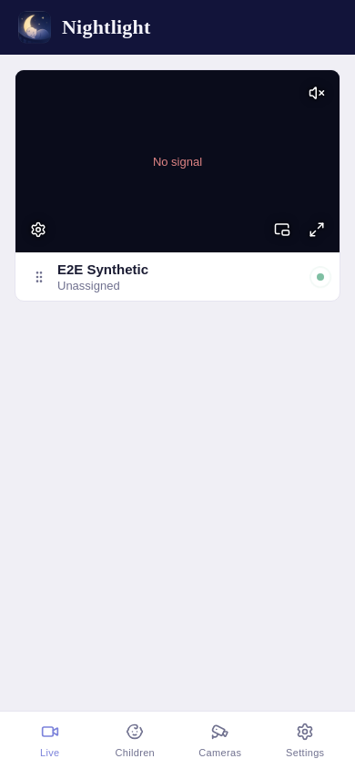
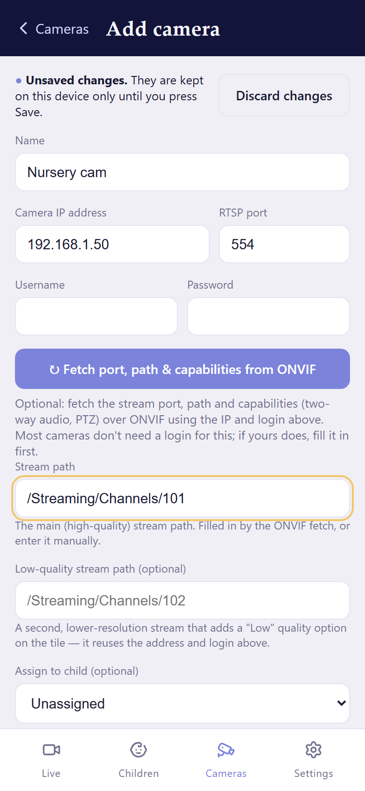
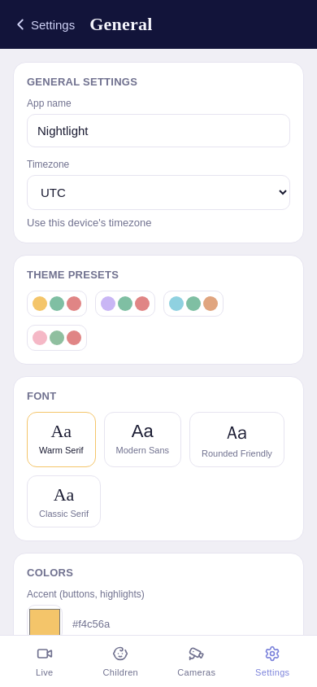

# Nightlight — your cameras, your baby monitor

**A private, self-hosted baby monitor built around the cameras you already own.**

Nightlight brings your nursery cameras together in one place. Check in on your little ones, listen to live audio, follow sleep activity and get optional alerts from your phone or computer — without a subscription or a Nightlight-hosted video service.

Built for parents. Friendly to self-hosters. Open source.

[Website](https://nightlightbaby.app/) · [Quick start](#quick-start) · [Documentation](docs/README.md) · [Report an issue](https://github.com/sauso/nightlight/issues)

> **Important:** Nightlight is a convenience tool, **not a safety or medical device**. Streams and alerts can fail. It must never replace adult supervision or be relied on to detect a child in distress.

## See Nightlight in action

| Live dashboard | Camera setup | Settings |
| --- | --- | --- |
|  |  |  |

[See the full walkthrough, including desktop screens](docs/README.md). These are test captures, not live camera footage, and may lag behind the latest UI.

## Why Nightlight?

- **Use your existing cameras.** Connect compatible RTSP cameras. On supported ONVIF cameras, Nightlight can fill in the stream details from the camera's IP address.
- **Watch with less delay.** WebRTC provides low-latency live video, with an HLS compatibility option.
- **Keep things in your hands.** Nightlight runs on your own Docker host and stores its settings and recordings locally.
- **One place for the nursery.** Group cameras by child and manage access for caregivers.
- **More than a live feed.** Explore sleep tracking, camera controls, recording and optional notifications.

Nightlight is designed for local-network use first. Remote viewing is possible, but requires additional setup.

## Quick start

You'll need an always-on Linux host running Docker (such as Unraid or an arm64 Raspberry Pi) and a camera that exposes an RTSP stream. ONVIF is useful but optional. Performance depends on your hardware, camera count and enabled analysis features; there isn't a published minimum-hardware benchmark.

On Unraid? Jump to [Running on Unraid](#running-on-unraid). Anywhere else, run Nightlight on a trusted home network:

```bash
docker run -d \
  --name nightlight \
  --network host \
  --restart unless-stopped \
  --log-opt max-size=10m \
  --log-opt max-file=3 \
  --stop-timeout 30 \
  -e PUID=99 \
  -e PGID=100 \
  -e TZ=UTC \
  -v /path/to/your/data:/app/data \
  sauso/nightlight:latest
```

Replace `/path/to/your/data` with a persistent folder on your host. `PUID=99` and `PGID=100` suit Unraid; on other hosts, choose the appropriate non-root user and group. Set `TZ` to your timezone if desired (it controls log timestamps).

`--stop-timeout 30` gives Nightlight time to finish saving a recording when the container is stopped; without it Docker can kill the container first. `--log-opt` stops Docker's logs growing without limit.

Open `http://<server-ip>:4000` from a device on the same network. Create your administrator account, add a child, then connect a camera from the **Cameras** tab.

Prefer Compose, or need different networking or storage settings? See the [installation guide](docs/installation.md).

## Running on Unraid

In **Community Applications**, search for **Nightlight**, select **Install**, check the data directory and apply. No extra plugin is needed. Then open `http://<server-ip>:4000` and follow the steps above to create your administrator account.

**Already installed from an older template?** Unraid keeps your saved template, so it doesn't pick up the shutdown setting by itself. Edit the container and make sure **Extra Parameters** contains `--stop-timeout 30`, so recordings can finish saving when the container stops.

[Manual template install and other setup details](docs/installation.md#unraid)

## What can it do?

**Live monitoring.** Watch multiple cameras, use audio and picture-in-picture, and switch between low-latency WebRTC and compatibility playback.

**Camera controls.** Add a camera by its IP address and let ONVIF fill in the stream details where it is supported, or set up the RTSP stream by hand. Use pan/tilt and two-way audio on cameras that support them.

**Sleep and recordings.** Review sleep activity and, if enabled, save motion/sound clips, wake clips or recordings you start yourself. See [how sleep tracking works](docs/sleep-tracking.md) and [recording options](docs/recording.md).

**Caregiver access.** Create accounts for people who need access to your nursery.

**Optional alerts.** Configure a supported notification provider to receive events when you're away from the app. [Learn how notifications work](docs/notifications.md).

**Mobile access.** Use the installable web app or the [Android and iOS companion apps](https://github.com/sauso/nightlight-mobile), including supported background audio features. The apps are installed from GitHub rather than an app store (the iOS app is sideloaded).

## Privacy and safety

Nightlight doesn't require a Nightlight cloud account or send your video to a Nightlight-hosted service. That doesn't mean every optional connection stays on your network:

- The default WebRTC setup uses a public Google STUN server, which can see connection metadata such as your public IP. You can disable it or use your own STUN server.
- Push notifications use whichever external or self-hosted provider you configure.
- Camera credentials and other secrets are stored unencrypted in the local database. Protect your data directory and backups.

Read [privacy, security and networking details](docs/networking.md) before exposing Nightlight outside your home network. For vulnerabilities, follow [SECURITY.md](SECURITY.md).

## Documentation

Start with the [documentation hub](docs/README.md), or jump directly to:

- [Installation and upgrades](docs/installation.md)
- [Cameras and controls](docs/cameras.md)
- [Networking and remote access](docs/networking.md)
- [Recordings](docs/recording.md)
- [Push notifications](docs/notifications.md)
- [Operations, backups and permissions](docs/operations.md)
- [Troubleshooting and known issues](docs/troubleshooting.md)
- [Architecture](docs/architecture.md)
- [Building and testing](docs/development.md)
- [Sleep tracking](docs/sleep-tracking.md)
- [Reverse proxy and remote access](docs/remote-access.md)
- [Adding caregivers](docs/caregivers.md)
- [Your home screen and the mobile apps](docs/mobile.md)
- [How it works](docs/how-it-works.md)

## Help make Nightlight better

Found a bug or have an idea? [Open an issue](https://github.com/sauso/nightlight/issues). Please don't post camera passwords, private video, tokens or other sensitive information in public reports.

Nightlight is MIT licensed. See [LICENSE](LICENSE).
