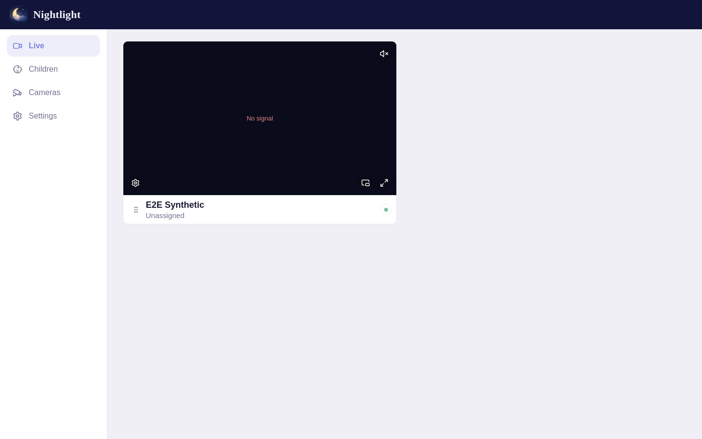
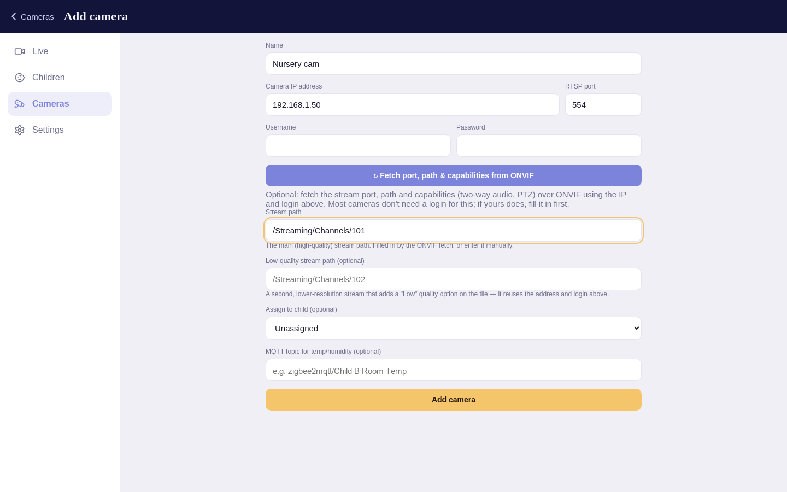
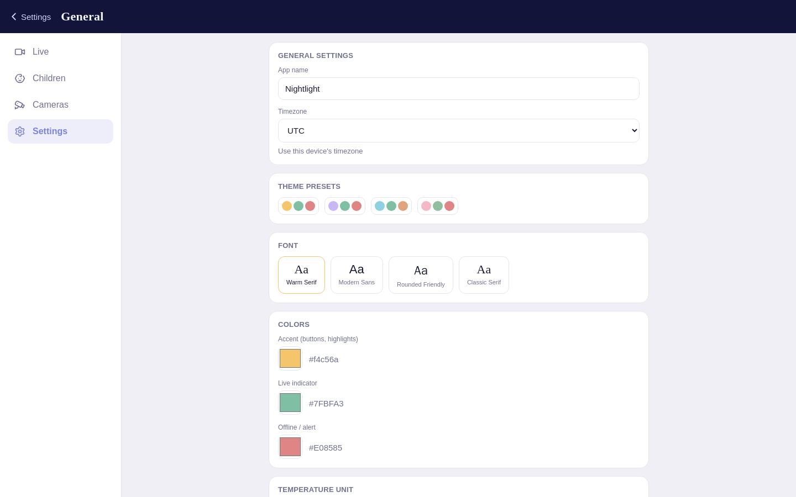

# Nightlight documentation

New here? Start with the [main README](../README.md), then choose the guide that matches what you're trying to do.

## Get Nightlight running

- [Installation](installation.md) — Unraid, Docker, Compose, storage and first setup
- [How it works](how-it-works.md) — FFmpeg, MediaMTX, the backend and the app, and how video reaches your browser
- [Cameras and caregivers](cameras.md) — add cameras and share access
- [Adding caregivers](caregivers.md) — what caregivers and admins can each do, and how long a sign-in lasts (`SESSION_TTL_DAYS`)
- [Networking and remote access](networking.md) — LAN options, WebRTC, STUN, HTTPS and privacy
- [Reverse proxy and remote access](remote-access.md) — SWAG, `TRUST_PROXY`, `STUN_SERVERS`, `CLOUDFLARE_ANALYTICS`, watching away from home
- [Troubleshooting](troubleshooting.md) — common problems and first checks
- [Known issues](../KNOWN-ISSUES.md) — documented limitations and workarounds

## Everyday features

- [Visual walkthrough](#visual-walkthrough) — dashboard, camera setup and settings
- [Camera controls](camera-controls.md) — PTZ and offline alerts
- [Sleep tracking](sleep-tracking.md) — how nights are estimated, corrected and reviewed, and its known limits
- [Recording](recording.md) — clips, wake events, manual recordings and retention
- [Your home screen and the mobile apps](mobile.md) — install as an app, Android and iOS, push on the apps
- [Push notifications](notifications.md) — supported providers and event delivery
- [MQTT](mqtt.md) — broker setup and sensor data
- [Multi-factor authentication](mfa.md) — enrollment and recovery

## Run and develop

- [Operations](operations.md) — backup, restore, permissions, upgrades and rollback
- [Architecture](architecture.md) — implementation details
- [Building and testing](development.md) — local development and tests
- [Design language](design-language.md) — UI conventions
- [Mutation testing](mutation-testing.md) — contributor test reference
- [Demo mode](demo-mode.md) — public read-only demo deployments
- [Security reporting](../SECURITY.md) — report vulnerabilities privately

## Visual walkthrough

These screenshots are captured by automated tests but committed manually, so they may lag behind the latest UI. They show a synthetic camera rather than real footage.

### Nursery dashboard

### Adding a camera

### Settings

For refreshing these captures, see [the e2e guide](../e2e/README.md#refreshing-the-documentation-screenshots).
