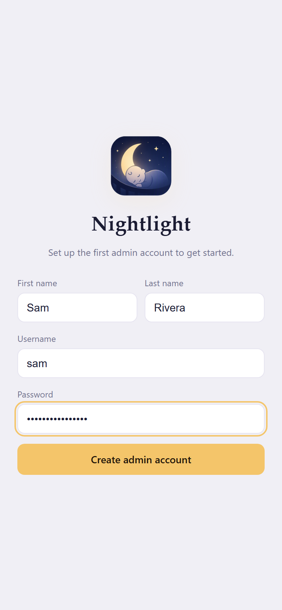
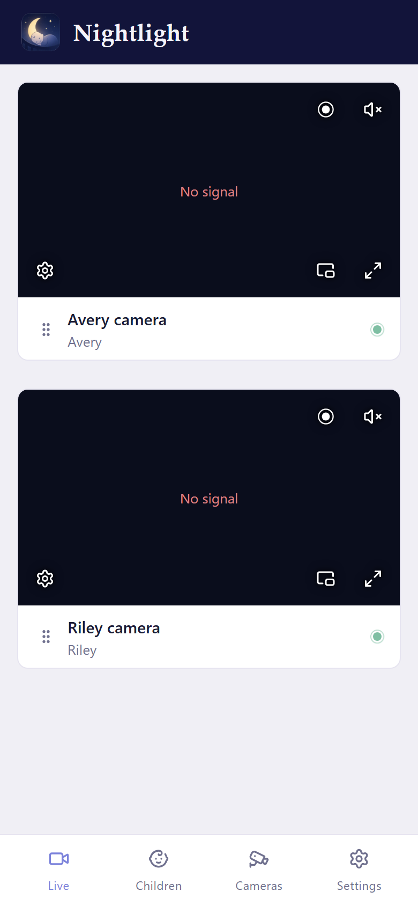
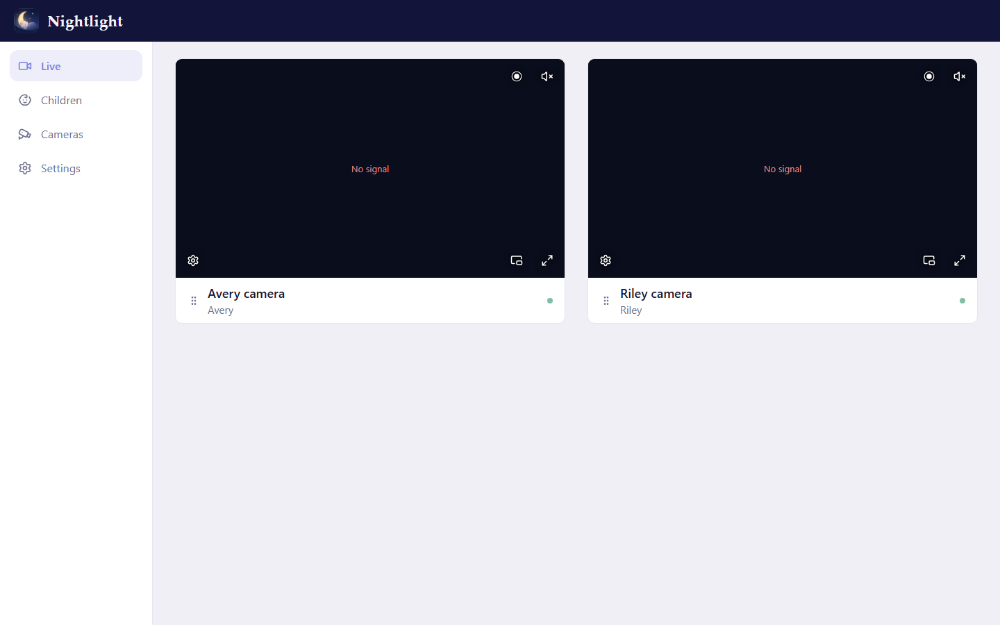
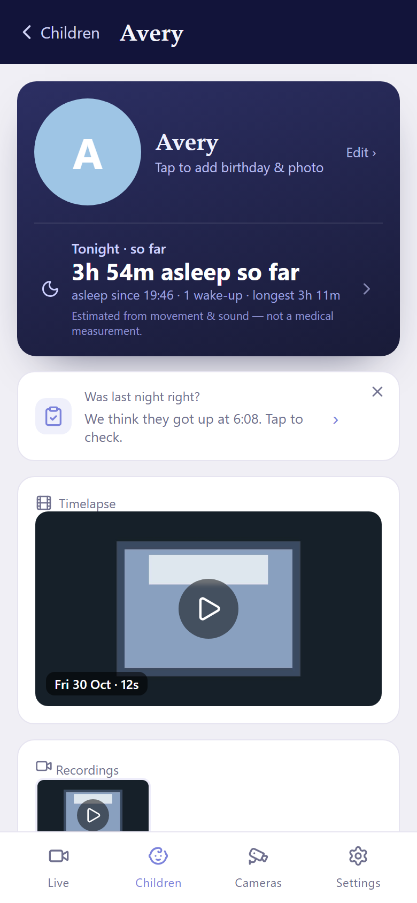
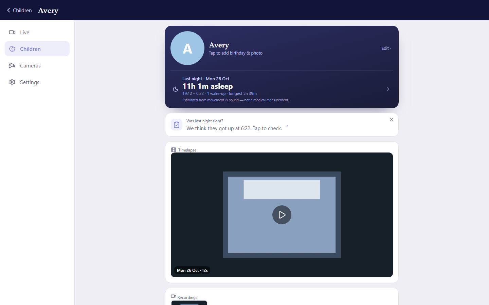
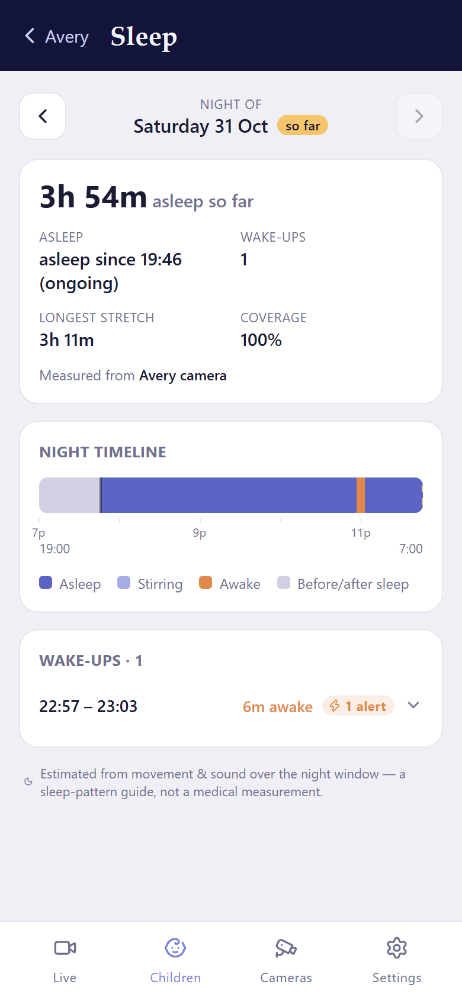
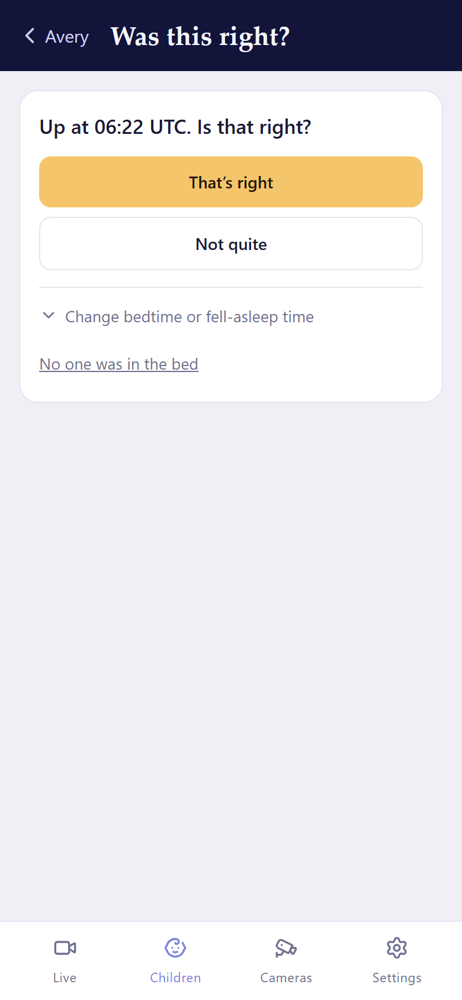
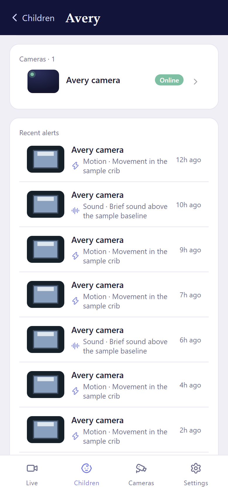
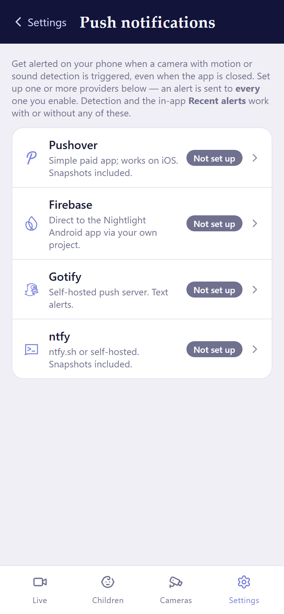
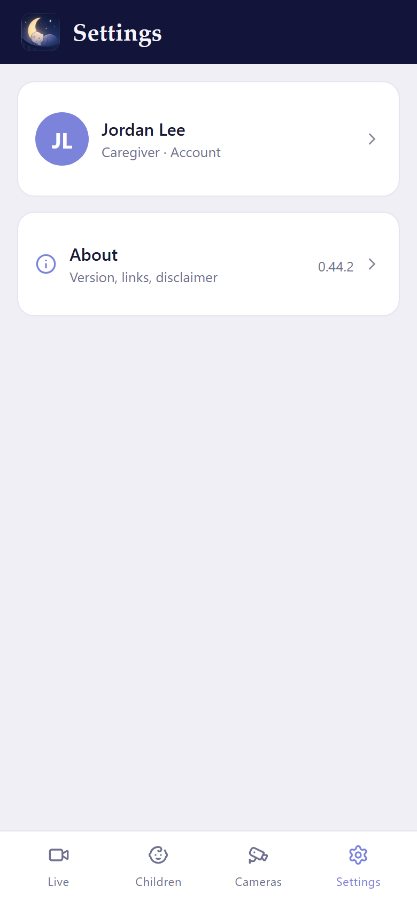

# Nightlight documentation

New here? Start with the [main README](../README.md), then choose the guide that matches what you're trying to do.

## Get Nightlight running

- [Installation](installation.md) — Unraid, Docker, Compose, storage and first setup
- [What you need, and what has been tested](requirements.md) — hosts, what each camera starts, disk, browsers and apps, and what has not been measured
- [How it works](how-it-works.md) — FFmpeg, MediaMTX, the backend and the app, and how video reaches your browser
- [Cameras and caregivers](cameras.md) — add cameras and share access
- [Adding caregivers](caregivers.md) — what caregivers and admins can each do, and how long a sign-in lasts (`SESSION_TTL_DAYS`)
- [Networking and remote access](networking.md) — LAN options, WebRTC, STUN, HTTPS and privacy
- [Reverse proxy and remote access](remote-access.md) — SWAG, `TRUST_PROXY`, `STUN_SERVERS`, `CLOUDFLARE_ANALYTICS`, watching away from home
- [Troubleshooting](troubleshooting.md) — common problems and first checks
- [Known issues](../KNOWN-ISSUES.md) — documented limitations and workarounds

## Everyday features

The Live page header button flips between light and dark. On every other page, change the theme
under Account → Appearance, where System follows your device again.
On About, **Got an idea?** opens a GitHub issue; you need a GitHub account. The idea form appears
after the next release to `main`; until then, the link opens a plain new issue.

- [Visual walkthrough](#visual-walkthrough) — setup, live view, sleep, alerts, notifications and a caregiver's view
- [Camera controls](camera-controls.md) — PTZ and offline alerts under Settings → Camera and Recording
- [Sleep tracking](sleep-tracking.md) — how nights are estimated, corrected and reviewed, and its known limits
- [Recording](recording.md) — clips, wake events, manual recordings and retention
- [Your home screen and the mobile apps](mobile.md) — install as an app, Android and iOS, push on the apps
- [Push notifications](notifications.md) — supported providers and event delivery
- [MQTT](mqtt.md) — broker setup and sensor data
- [ESPHome data collection](esphome.md) — direct device connection, raw minute readings and retention
- [Multi-factor authentication](mfa.md) — enrollment and recovery

## Run and develop

- [Operations](operations.md) — backup, restore, permissions, upgrades and rollback
- [Architecture](architecture.md) — implementation details
- [Building and testing](development.md) — local development and tests
- [Design language](design-language.md) — UI conventions
- [Mutation testing](mutation-testing.md) — contributor test reference
- [Demo mode](demo-mode.md) — public read-only demo deployments
- [Security reporting](../SECURITY.md) — report vulnerabilities privately

## Visual walkthrough

A short tour of Nightlight with a made-up household: two children, Avery and Riley, one camera each, and two weeks of invented nights. Nothing here is real footage or real data. The video is a plain synthetic picture, and the sleep, alerts and recordings are generated, so none of it was recorded in a real home. Notifications show as "Not set up" because that is how a fresh install looks. The images may lag behind the latest screens.

### 1. Create the admin account

The first time you open Nightlight it asks you to create the admin account. This is the only time you see this screen.

### 2. Watch live

The Live tab shows every camera. On a wide screen the navigation moves from the bottom of the screen to a side bar on the left.

### 3. A child's overview

Each child has a page showing last night's sleep, a prompt to check it, the nightly timelapse, recordings and recent alerts. See [Sleep tracking](sleep-tracking.md) for how nights are estimated and what the limits are.

### 4. Last night in detail

Tap the summary to see the night as a timeline, with each wake-up. The numbers are an estimate from movement and sound, not a medical measurement.

### 5. Check the estimate

The morning check asks one question: is the wake time right? Choose **That's right**, or **Not quite** and enter the right time. Changing the bedtime, or saying no one was in the bed, is below it.

### 6. Recent alerts

Motion and sound alerts are listed on the child's page, each with a snapshot from the camera. Here the snapshots are the synthetic picture.

### 7. Add a camera

Enter the camera's address and stream details, or use the ONVIF button to fill them in. This form holds example values and was not saved. See [Cameras and caregivers](cameras.md).

### 8. Set up notifications

Settings → Integrations → Push notifications lists the providers. An alert goes to every provider you turn on. See [Push notifications](notifications.md).

### 9. What a caregiver sees

A caregiver can watch and check on the children, but the camera, user and notification settings are for admins. A caregiver's Settings page shows only their own account and About. See [Adding caregivers](caregivers.md) for the full list.

To refresh these images, see [the e2e guide](../e2e/README.md#refreshing-the-documentation-screenshots).
